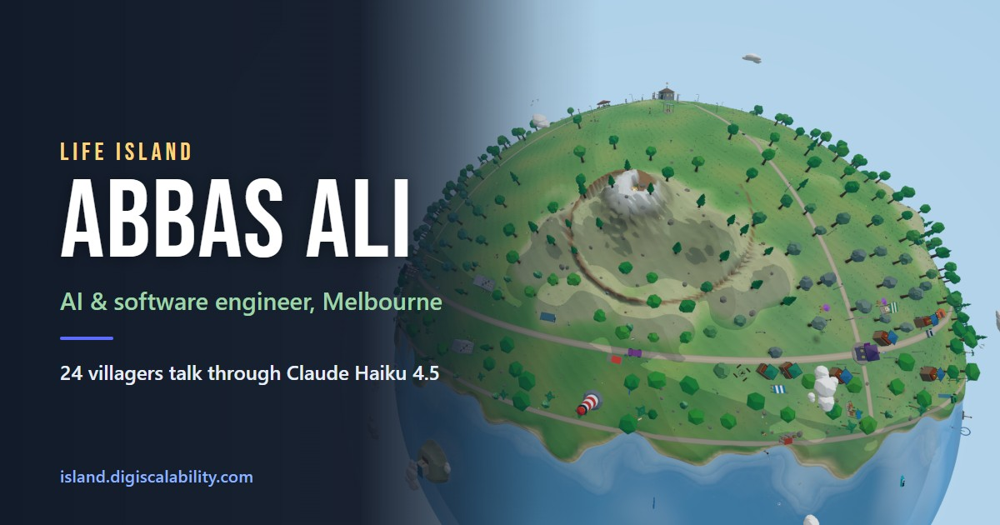

# Life Island

[](https://github.com/digiscalability/portfolio-island/actions/workflows/ci.yml)

**Live: [island.digiscalability.com](https://island.digiscalability.com)**

A living 3D world (Three.js + TypeScript) where 24 villagers talk through
Claude Haiku 4.5. You walk a small planet as a third-person character: a hub
town at the north pole, four districts around it, 28 villagers going about
their day, other visitors in real time, races, deliveries and buildings you can
walk into.

Built and run by Abbas Ali, AI & software engineer, Melbourne
([LinkedIn](https://www.linkedin.com/in/-abbas-ali) ·
[admin@digiscalability.com](mailto:admin@digiscalability.com)).
I build AI products end to end and make them safe to put in front of the
public: the model call and its guardrails, the realtime client, the cloud
functions and the tests. This repo has all four.



Inspiration: [Messenger](https://messenger.abeto.co) by Abeto.

## For reviewers (10 min)

Six stops, in order. Each one is short and says why it is built that way.

1. **[npcChat's guardrails](https://github.com/digiscalability/portfolio-island/blob/main/functions/src/index.ts#L329-L466)**
   (`functions/src/index.ts`). The villager chat endpoint: App Check, a per-IP
   burst limit, a hard monthly token cap, moderation before and after the
   model, the visitor's text sent as data and never as instructions. When any
   check trips, the villager answers with a scripted line and the fallback is
   counted by reason.
2. **[The money logic and its tests](https://github.com/digiscalability/portfolio-island/blob/main/test/functionsPure.test.ts)**
   (`test/functionsPure.test.ts`). The rate window, the prune selection and
   the seeded fallback pick, pulled out into `functions/src/pure.ts` so they
   run in plain Vitest without a Firebase emulator.
3. **[The planner invariant](https://github.com/digiscalability/portfolio-island/blob/main/functions/src/plannerPrompt.ts#L48-L74)**
   (`parsePlanReply`). The daily planner may only pick ids from fixed lists;
   whatever the model writes, only pool ids reach the world, so no planner text
   reaches a public surface.
4. **[The agentSession gate](https://github.com/digiscalability/portfolio-island/blob/main/functions/src/agentSession.ts#L1-L34)**
   (`functions/src/agentSession.ts`). A voice agent connects the browser
   straight to the vendor, so this function mints the short-lived signed URL
   the browser needs. Its header lists the five defence layers in order and
   the incident that prompted them.
5. **[The tierParity census](https://github.com/digiscalability/portfolio-island/blob/main/test/tierParity.test.ts#L98-L170)**
   (`test/tierParity.test.ts`). A phone and a desktop must build the same
   seeded world, because multiplayer addresses parked cars by index. A golden
   census fails on any change that moves the world.
6. **[ci.yml](https://github.com/digiscalability/portfolio-island/blob/main/.github/workflows/ci.yml)**.
   Typecheck, lint, Prettier, the tests, both builds, and the offline evals,
   on every push and pull request.

Then [ARCHITECTURE.md](ARCHITECTURE.md) for a reading path through the rest.

## The AI parts

- **24 villagers on Claude Haiku 4.5.** Walk up to one and press E. The
  `npcChat` Cloud Function (a Firebase callable) answers as that villager,
  from a persona that never leaves the server. The Anthropic key lives in
  Secret Manager. Anonymous sign-in IDs are free to mint, so the burst limit
  is keyed by IP. When the monthly cap is hit, or anything else trips, the
  villager falls back to scripted lines.
- **A daily planner.** At 6am Melbourne time one Claude Haiku 4.5 call gives
  each villager a job and picks the day's event, choosing only from fixed
  lists. If the call fails or the cap is reached, a seeded fallback still
  writes a valid plan.
- **A nightly analyst.** At 9pm a Claude Sonnet call turns the day's database
  counts into a private email digest and proposes small improvements, which
  it files as GitHub issues (label `island-analyst`). Before filing, it
  replaces traffic figures with `[n]`; filing has a three-day cooldown and a cap
  of five open issues, and analyst issues idle for 14 days are closed. A
  proposal closed in the last 90 days is never filed again, and the model is
  shown those titles so it does not re-word one.
- **Voice.** A villager's reply can be spoken by ElevenLabs through
  `npcVoice`, a capped function that only voices text `npcChat` just produced;
  the browser's own speech is the fallback. Visitors can also speak to
  villagers (speech-to-text in the browser). The reception desk's voice agent
  gets its session from `agentSession`.
- **No model in the world's mood.** A rule-based `director` picks the island's
  mood and headline every six hours from pre-written lists.

## Evals

[evals/](evals/) tests the shipped guardrails from Python (3.11, uv, pytest),
against the built Cloud Functions rather than a copy of their rules.

- **Offline suites** (no network, no API key): moderation precision and recall
  over a labelled corpus, the injection fence and facts rules in every villager
  prompt, adversarial planner replies through the real validator, and a scan
  of the public pages for claims they must not make. CI's `offline-evals` job
  runs them on every push.
- **Live suites** (injection and role-break attempts, facts about Abbas, planner
  id validity) call the API under a hard token budget and run only by manual
  dispatch. They have not been run yet.

Scores, including the known gaps and known costs of a word list:
[evals/RESULTS.md](evals/RESULTS.md).

## Numbers

Checked against the code on 2026-11-02.

| Item | Value |
| --- | --- |
| Tests | 832 Vitest tests in 48 files (`CI=true npx vitest run`), plus the offline evals |
| World | `WORLD_RADIUS` 100 (`WorldScale.ts`): the Welcome hub at the north pole and four districts on a ring at 26.6°N, 90° apart (`Districts.ts`) |
| Villagers | 28; 24 talk through Claude Haiku 4.5 (`AI_NPCS` in `NpcChat.ts`), and the two market vendors, the first mate and the deckhand use scripted lines |
| Cloud Functions | 9: `npcChat`, `npcVoice`, `agentSession`, `planner`, `analyst`, `director`, `janitor`, `onLeadCreated`, `vaultOp` |
| 3D models | 7 `.glb` files, 289 KiB on disk, about 86 KiB as served (brotli) |

## Run it locally

Node 22.

```bash
npm ci
npm run dev        # Vite on http://localhost:5173
npm test           # Vitest
npm run check      # typecheck, lint (zero warnings), Prettier check
npm run build      # production build into dist/
cd functions && npm ci && npm run build    # the Cloud Functions
```

Without an App Check site key (`VITE_APPCHECK_SITE_KEY`), `npcChat` refuses
the call and the villagers use their scripted lines. The tests make no network
calls: fetch and model loads are stubbed in `test/helpers/networkStubs.ts`. To
run the evals, see [evals/README.md](evals/README.md).

## Controls

| Key | Action |
| --- | --- |
| W A S D or arrow keys | Move |
| Mouse drag (left or right button) | Look |
| J / L | Turn the view (I / K tilt it, R recentres it) |
| Space | Tap to jump; hold while moving to run (uses stamina); hold in water to stay afloat |
| Shift | Hold in water to dive |
| E | Talk, enter, sit or use, whatever the on-screen prompt says |
| Q | Wave (nearby villagers wave back) |
| F | Scatter bird feed |
| G | Eat a cooked meal (restores stamina) |
| M | Island map |
| Enter | Type a message to visitors nearby |
| V | Hold to talk to visitors nearby |
| P | Take a photo postcard |
| C | Change your look |
| Esc | Close panels |

On a phone: a joystick to move, swipe to look, and on-screen buttons.

## How it is built

- **Client:** Three.js + TypeScript + Vite. The entry is `main-simple.ts`;
  `GameScene.ts`, `Island.ts` and `SimpleUI.ts` hold the scene, the planet and
  the HUD. World generation is seeded, so every device builds the same world.
- **Backend:** Firebase. Anonymous Auth and the Realtime Database carry
  presence, profiles, the guestbook, leaderboards and the bank vault; nine
  Cloud Functions (Node 22) hold every key and enforce every spending limit.
  The client loads Firebase lazily, off the startup path.
- **Deploys:** Vercel for the client; `firebase deploy --only functions:<name>`
  for the server.
- **Operations:** [docs/runbook.md](docs/runbook.md) lists every `ALERT`
  marker the functions log and what to do about it.

## How I work with coding agents

Most commits here were made with Claude Code (they carry a Claude co-author
line), and the repo is set up for that way of working:

- **Rules the agent reads first.** [CLAUDE.md](CLAUDE.md) holds the stack, the
  recurring traps and three World Laws: things that stand, stand plumb; the
  avatar rigs have non-identity rest poses; measure the rig, don't reason about
  it. Each was learned by shipping the opposite and having it reported as
  broken, so it is written where the next session reads it before touching an
  asset.
- **One handoff between sessions.** [.claude/LOCAL-STATE.md](.claude/LOCAL-STATE.md)
  is rewritten at every checkpoint (the branch, the files in flight, what was
  verified, the next step) so that a session with no other context can resume.
  Older handoffs move to [docs/history/](docs/history/).
- **Tests as pins.** A fix that could regress silently lands with a test that
  fails on the regression: the golden census in `tierParity.test.ts`,
  `radiusUnits.test.ts` failing the build on a hand-written radian, the
  client and server lists kept in lockstep by `livingNpcs.test.ts`. Some pins
  read source text instead of running it (shader strings, DOM wiring, lists
  that live in two build roots); 23 of the 48 test files do that at least once.
- **Verify before claiming.** A visual fix isn't done until a fresh screenshot
  of the affected state shows it, and the numbers in this README were measured,
  not remembered.

## Licence

The code is open source under the MIT License: see [LICENSE](LICENSE).
Third-party models, textures, fonts and other assets keep their own licences,
listed in [CREDITS.md](CREDITS.md).

## More

- [ARCHITECTURE.md](ARCHITECTURE.md): the reading path and the subsystems.
- [CREDITS.md](CREDITS.md): where the models, fonts and sounds come from.
- [SECURITY.md](SECURITY.md): how to report a problem, and how secrets are kept.
